# Build vs. buy: replacing Power Apps with Devin

*For the VP of Engineering. About 5 minutes. Scroll top to bottom; the italic "Say" lines are talking points.*

---

## 1. What Power Apps really gives you

| What you get | Why it matters to you |
|---|---|
| **Sign-in and permissions** (Entra ID, MFA, group sharing) | Comes free with Microsoft 365 |
| **Governance and audit logs** | Auditors already accept them as evidence |
| **No ops work** | Microsoft runs hosting, patching and uptime |
| **Non-engineers build their own apps** | Ops staff don't have to wait on engineering |
| **Compliance coverage** | Microsoft's attestations cover the platform |

**$250K a year ÷ $20 per user per month ≈ 1,000 licensed users**, about 17× your engineering team.

> *Say:* "What you're paying for isn't the forms. It's the layer underneath. And $250K means about a thousand users, so the people using these tools are mostly ops and compliance staff. Whatever replaces Power Apps has to work for them."

---

## 2. How Devin helps if you build

We had Devin build the layer underneath first, then put your three apps on top of it.

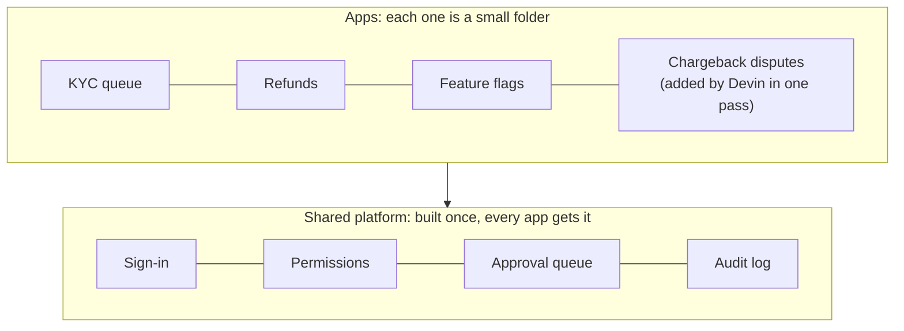

### Each person only sees what their role allows
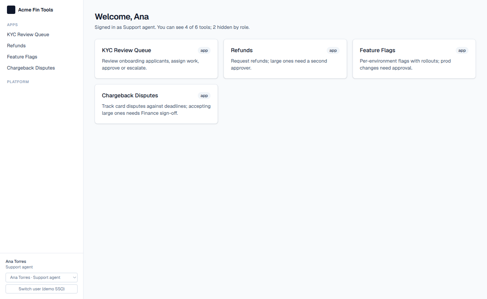

> *Say:* "Ana is a support agent. She sees four of the six tools. Approvals and the audit log are hidden for her role."

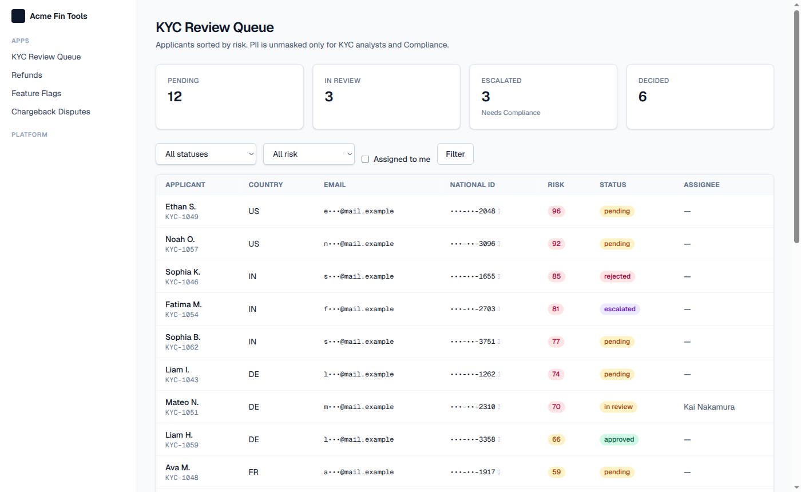

> *Say:* "Personal details are masked for her, and the server does the masking, not just the screen."

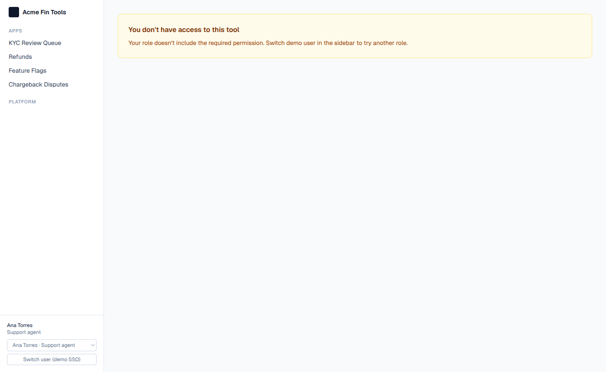

> *Say:* "If she types the audit log address in directly, she's blocked. The server checks permissions on every page and every action."

### Large refunds need a second person
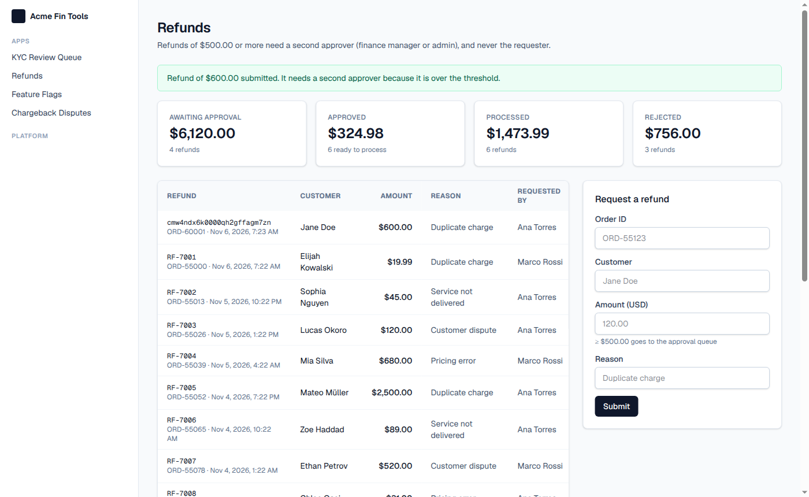

> *Say:* "Ana requests a $600 refund. Anything over $500 needs a second approver, so it goes to the approval queue."

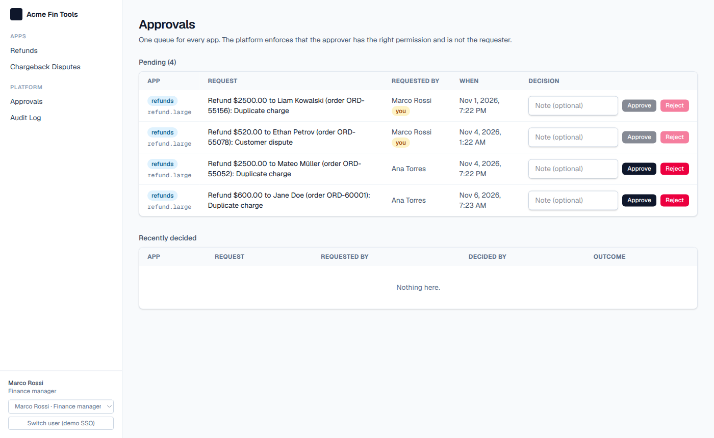

> *Say:* "This is the approval queue, shared by every app. Marco, the finance manager, can approve Ana's refund. The two greyed-out rows are refunds he requested himself, so he can't approve those."

### Production changes need approval too
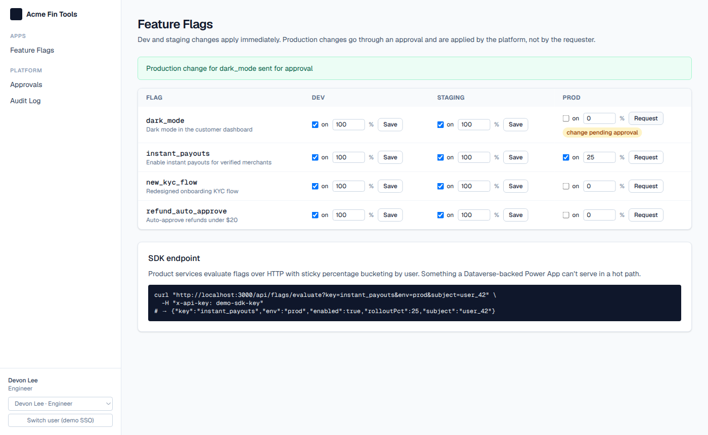

> *Say:* "Same pattern for feature flags. Devon changes staging and it applies right away. A production change goes to the same approval queue."

### Every action is recorded, and edits are detectable
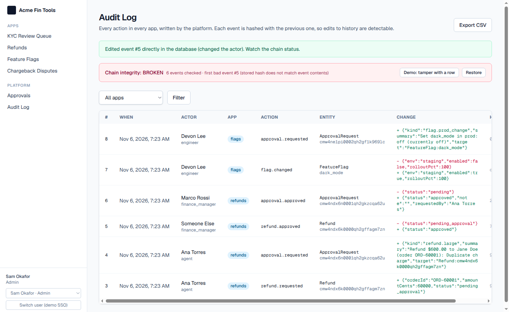

> *Say:* "Everything we just did is in the audit log. Each row is linked to the one before it, so when someone edits a row directly in the database, the log shows the chain as broken. Auditors can export it as a CSV."

### Adding app number eleven
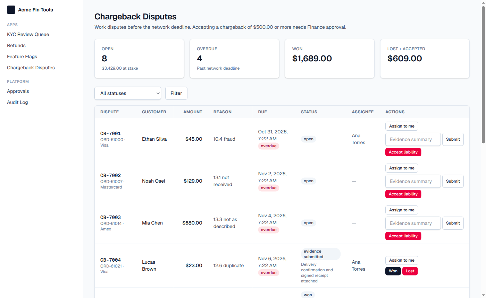

> *Say:* "This app wasn't one of yours. Devin built it in about a minute and a half, following the conventions file in the repo, and it got sign-in, permissions, approvals and the audit log for free. That's what adding new apps looks like."

---

## 3. Honest assessment: what's replicable, what's not, where the risk is

| ✅ Easily replicable with Devin | ⚠️ Replicable, but you own it from then on | ❌ Not realistically replicable |
|---|---|---|
| Your three apps, and the next ten | Real sign-in (Okta/Entra): about a week | Ops staff building their own apps |
| Permissions, approvals, audit log | Hosting, backups, monitoring, on-call | Microsoft's compliance coverage, which you'd rebuild yourself |
| Things Power Apps can't do well: server-side masking, tests, a flag SDK | Security patches and upgrades across 13+ apps | |

**Where the risk is:** owning and running it, not building it.
- You need one named person to own the platform.
- Code review is the real work. Tests passed the whole time, yet a browser test and a code review still found real bugs (approvals that weren't atomic, a PII leak). All were fixed, and the cost model budgets review time.

> *Say:* "Devin can build all of this. What it doesn't remove is the job of owning it in production, and your ops team can no longer build apps themselves."

---

## 4. Recommendation: build, timed to your renewal, if headcount keeps growing

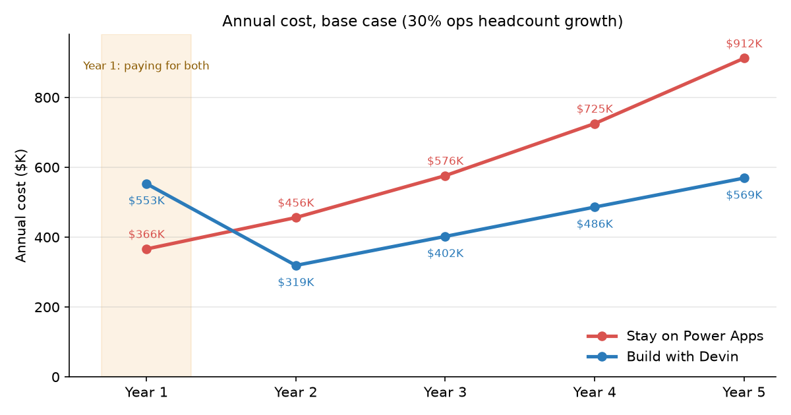

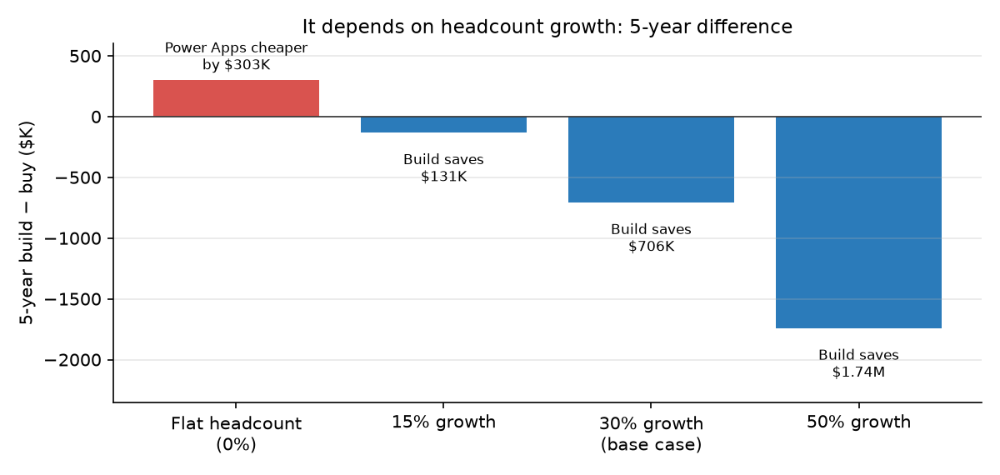

| | |
|---|---|
| **Year 1** | About $190K more, because you pay for both while you migrate |
| **Break-even** | Year 3 |
| **5-year savings** | About $700K at 30% ops headcount growth |
| **If headcount stays flat** | Stay on Power Apps: it's about $300K cheaper over 5 years |

**Why:** Power Apps charges per user and your ops team keeps growing. A platform you own costs engineering time, which barely changes as you add users.

**Conditions:**
1. **All or nothing.** Anyone who still uses one Power App still needs a license.
2. **Name a platform owner** before anything goes to production.
3. **Accept that ops loses self-service.** Use a fast request path instead.

> *Say:* "Year one costs more. After that it's cheaper, and the gap grows with every person you hire. If your headcount is flat, stay where you are."

---

## 5. Next steps, and where Devin fits

| If you build | If you stay on Power Apps |
|---|---|
| **Now:** confirm the renewal date and license type, and name the owner | Devin builds custom connectors and backend APIs that your Power Apps call |
| **Weeks 1–3:** platform with real sign-in, Postgres, monitoring | Devin writes test automation around your apps |
| **Weeks 3–5:** refunds first, running alongside the Power App | Devin moves complex logic out of Power Fx into reviewed code |
| **Then:** about one new app a week as Devin pull requests, each reviewed by an engineer; KYC last; don't renew | |

> *Say:* "Either way, Devin has a role. If you build, it writes every app as a pull request your engineers review. If you stay, it handles the integration and testing work around Power Apps. Thanks."
